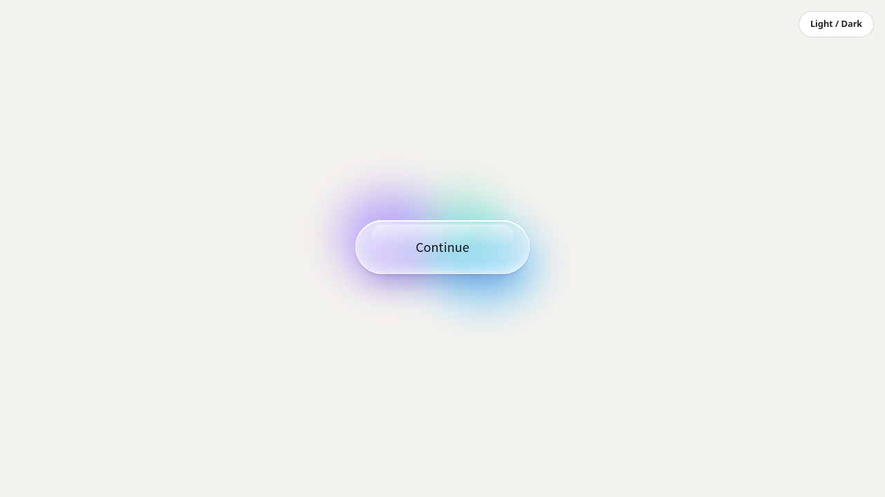
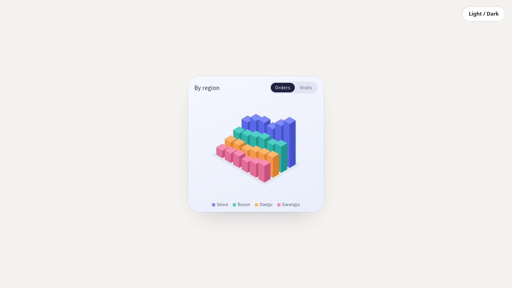

# SOURCEOFKNOWLEDGFORAI

An agent-ready front-end knowledge base: **5,768 reference files** collected from three public design
libraries, normalised into markdown prompts with metadata, categories and source links.

Built to be cloned by an AI coding agent (Arena, Claude Code, Codex, Cursor, OpenCode) so it can look up a
real pattern before writing UI code instead of inventing one.




## What is inside

| Source | Items | What you get | License |
|---|---:|---|---|
| [`sources/codefronts/`](sources/codefronts/) | 5,047 | CSS/Tailwind components, layouts, navigation, motion, snippets, design styles. One ready-to-paste AI prompt per item, code included. | MIT (stated by CodeFronts) |
| [`sources/lucianlabs/`](sources/lucianlabs/) | 400 | 200 interface + 200 animation elements. Full prompt, working HTML/CSS/JS, theme tokens, runnable demo files. | MIT (c) 2026 Seokwoooo |
| [`sources/motionsites/`](sources/motionsites/) | 321 | Free website-section prompts: hero, pricing, footer, ecommerce, SaaS, dashboards. | Free prompts, property of MotionSites AI |

**Paid MotionSites prompts are not included.** The archive only stores what the site publishes as free
(`is_free = true`). No paywall was bypassed. See [`NOTICE.md`](NOTICE.md).

## Quick start

```bash
git clone https://github.com/broamstuck-cybr/SOURCEOFKNOWLEDGFORAI.git
cd SOURCEOFKNOWLEDGFORAI
```

1. Read [`AGENT.md`](AGENT.md) — the rules an agent must follow when using the archive.
2. Browse [`INDEX.md`](INDEX.md) — counts, categories and highest-value picks.
3. Copy a recipe from [`docs/usage-recipes.md`](docs/usage-recipes.md).
4. Connect Arena with [`docs/arena-setup.md`](docs/arena-setup.md).

Minimal Arena message:

```
Read AGENT.md in broamstuck-cybr/SOURCEOFKNOWLEDGFORAI.
Build <feature> in <folder> using at most two references from sources/.
Keep license headers, use design tokens, verify 390/768/1440 + reduced motion.
```

## Repository map

```text
.
├── AGENT.md                  # rules and retrieval workflow for agents
├── INDEX.md                  # generated entry point
├── NOTICE.md                 # attribution, licenses, takedown
├── catalog.json              # machine summary of the archive
├── sources/
│   ├── codefronts/           # 5,047 prompts, folder = section/category
│   ├── lucianlabs/           # 400 prompts + demos + tokens.css
│   └── motionsites/          # 321 free prompts + full public catalogue
├── docs/
│   ├── arena-setup.md
│   ├── usage-recipes.md
│   └── repository-map.md
├── scripts/                  # collectors, index builder, verifier
└── assets/previews/          # screenshots of selected elements
```

## Search without loading everything

Every source has a `manifest.json` with `id`, `title`, `category`, `tags`, `path`.

```bash
# find animation references
jq -r '.[] | select((.title + " " + .category + " " + ((.tags // []) | join(" "))) | test("scroll|parallax"; "i")) | [.title, .path] | @tsv' \
  sources/lucianlabs/manifest.json

# find pricing sections
jq -r '.[] | select(.category == "Pricing") | [.title, .path] | @tsv' sources/motionsites/manifest.json
```

## How files are shaped

CodeFronts and lucianLabs files are **prompts**, not just docs. Send the whole file to an agent and it has
the brief, the code and the constraints. MotionSites files are section briefs: layout, type, spacing and
interaction described in detail.

## Refresh the archive

```bash
python3 scripts/crawl_codefronts.py --resume --concurrency 12
python3 scripts/fetch_lucian.py
python3 scripts/fetch_motionsites.py 4
python3 scripts/build_index.py
python3 scripts/verify.py
```

`verify.py` checks file counts, frontmatter, demos and that no paid MotionSites prompt leaked in.

## Scope and honesty

- This is a **learning reference**. Adapt the patterns; do not ship the demo copy or third-party assets.
- External image, font and video URLs inside prompts belong to their owners and may expire.
- The archive is a snapshot. Sites change; re-run the collectors if a link is stale.
- If you own content here and want it removed, open an issue.

## Tóm tắt tiếng Việt

Repo này là kho tham chiếu front-end cho AI agent: 5.768 file, gồm 5.047 component CodeFronts, 400
element MIT của lucianLabs (kèm demo chạy được) và 321 prompt section miễn phí của MotionSites.
Prompt trả phí của MotionSites **không** được thu thập. Agent đọc `AGENT.md` trước, tra `manifest.json`
để tìm mẫu phù hợp, mở tối đa 2–3 file rồi mới code. Xem `docs/usage-recipes.md` để lấy câu lệnh mẫu.

## License

Archive structure, docs and scripts: MIT. Third-party content keeps its original license and attribution —
see [`NOTICE.md`](NOTICE.md).
